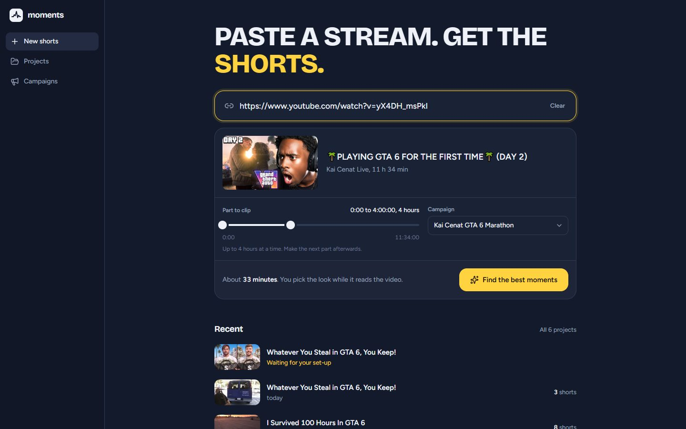
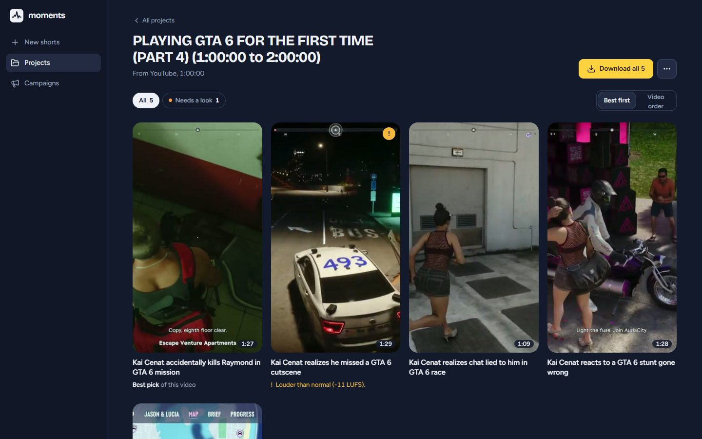
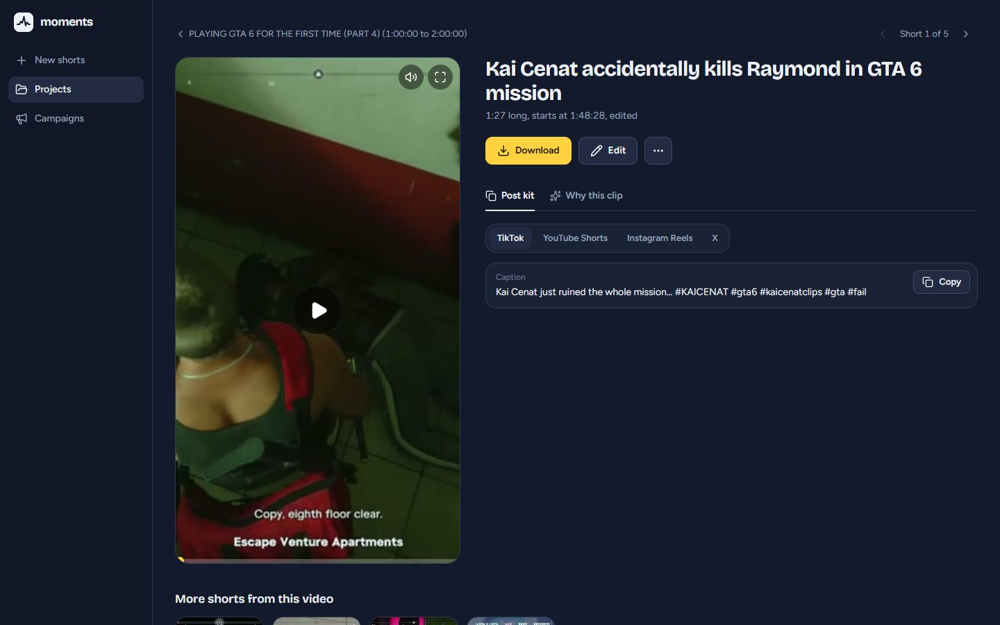
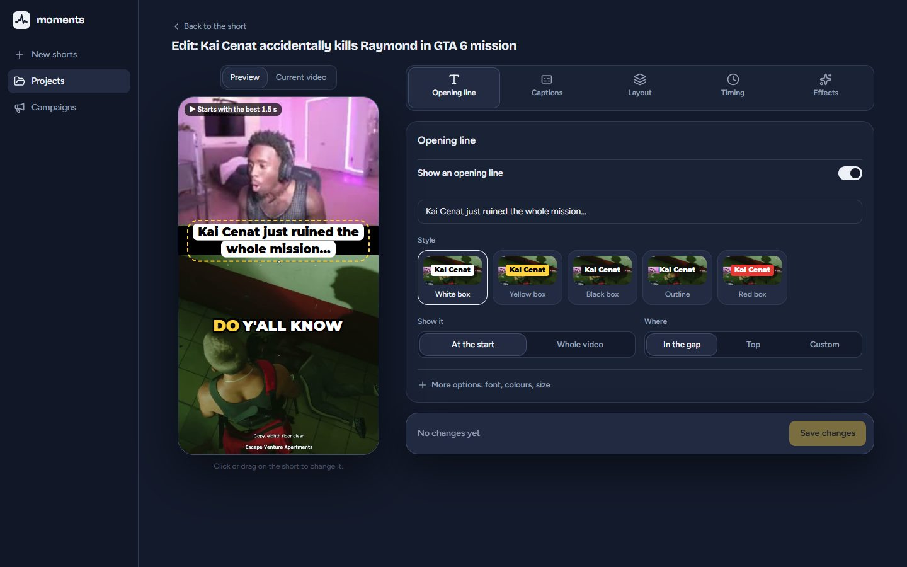

# Moments Clipper

**Free AI clipper for long gaming streams.** Paste a YouTube link (up to 24 hours) or drop a recording, and get vertical shorts with captions, an opening line, a facecam layout and ready-to-paste titles and hashtags.

A free, open-source alternative to paid clipping tools. Runs on your own PC: no sign-up, no watermark, no monthly fee.

<p align="center"></p>

## What it does

- **Finds the moments worth posting.** It listens to the whole stream, reads what was said, measures how loud it got, and reads the **live chat replay**, so it knows where viewers went wild. An AI then picks the best standalone moments and starts each short right on the action.
- **Handles really long streams.** Paste the link and pick the part on a slider (up to 4 hours at a time). Only that part is downloaded, in small pieces at once, so 12-hour streams work on slow internet too.
- **Frames the streamer.** It finds the facecam anywhere on screen (also two people side by side) and puts it above or below the gameplay. You can drag the box if needed.
- **Captions and opening line.** Word-by-word captions in several looks, an opening line that tells scrollers why to stay, the best second shown first, a zoom on the loudest moments and a progress bar.
- **Clipping campaigns.** Paid clipping programs (like Content Rewards) have rules: name the streamer, use these hashtags, avoid that. Save a campaign once; every short, title and caption follows it.
- **Checks every short.** Sound set to -14 LUFS (what YouTube and TikTok play at), and a check for black or frozen pictures, silence and wrong length, with a one-click fix.
- **Post kit.** Title, caption and hashtags for TikTok, YouTube Shorts, Instagram Reels and X, ready to copy, plus a ZIP with everything.
- **Edit without an editor.** Change the timing, captions, layout or opening line on a live preview; the short is made again in about a minute.

| Your shorts | One short, ready to post |
|---|---|
|  |  |

| Edit on a live preview |
|---|
|  |

## What it costs

Nothing, with the free [Groq](https://console.groq.com/keys) key: speech-to-text and the moment picker both run on Groq's free tier.

Optional: add an [Anthropic](https://console.anthropic.com) key and **Claude** picks the moments and writes the titles (better picks, paid per use; a 1-hour part costs a few cents). Without it, Groq does everything.

## Install

You need **Node.js 20+**, **Python 3.10+** and **ffmpeg**.

| | Windows (PowerShell) | macOS | Linux (Debian/Ubuntu) |
|---|---|---|---|
| Node.js | `winget install OpenJS.NodeJS.LTS` | `brew install node` | [nodejs.org](https://nodejs.org) |
| Python | `winget install Python.Python.3.12` | `brew install python` | `sudo apt install python3 python3-pip` |
| ffmpeg | `winget install Gyan.FFmpeg` | `brew install ffmpeg` | `sudo apt install ffmpeg` |

Open a **new** terminal after installing them, then:

```bash
git clone https://github.com/fadikodaz/moments-clipper.git
cd moments-clipper
npm install
npm run setup
npm start
```

`npm run setup` checks the tools, installs the Python packages, asks for your Groq key (and optionally a Claude key), and builds the app. Then open **http://localhost:3000**.

Keys are saved in `engine/.env` on your PC and never leave it except to call Groq or Anthropic.

## How it works

1. **Audio and chat.** Only the sound of your chosen part is downloaded (plus the live chat replay if the stream has one).
2. **Speech to text.** Groq Whisper, with a time for every word.
3. **Signals.** Loudness per second, and chat speed per 10 seconds with the words chat spammed.
4. **Moment picking.** The AI reads the transcript in 15-minute parts with `LOUD` and `CHAT x6: "LMAO" x30` marks, and proposes standalone moments with a title, an opening line and a score.
5. **Render.** For each pick, a few seconds of video around it are downloaded and cut into a 1080x1920 short with ffmpeg: facecam and gameplay layout, captions, opening line, loudness fix.
6. **Quality check.** Every short is measured and flagged if something is off.

The engine is Python (`engine/`), the app is Next.js (`src/`). Everything runs locally; projects are stored in `data/`.

## Good to know

- **Respect the creators.** Clips belong to the streamers. Only clip creators who allow it, follow their rules and campaign terms, and credit them. See [NOTICE.md](NOTICE.md).
- **YouTube** sometimes refuses downloads for a while; the app retries and falls back automatically.
- **Speed** depends on your internet. On a slow connection, a 1-hour part takes about 10-15 minutes from link to finished shorts.

## Credits

Built with ffmpeg, yt-dlp, OpenCV (YuNet face model, MIT), Groq Whisper and Claude. The chat-spike and quality-check ideas were inspired by [gta6-clipper](https://gitlab.com/nocodehack.io/gta6-clipper) by NoCodeHack (MIT); the code here is our own.

## License

MIT, see [LICENSE](LICENSE). Fonts keep their own licenses.
